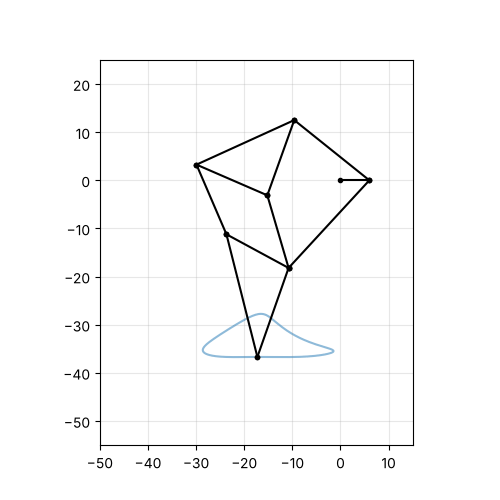
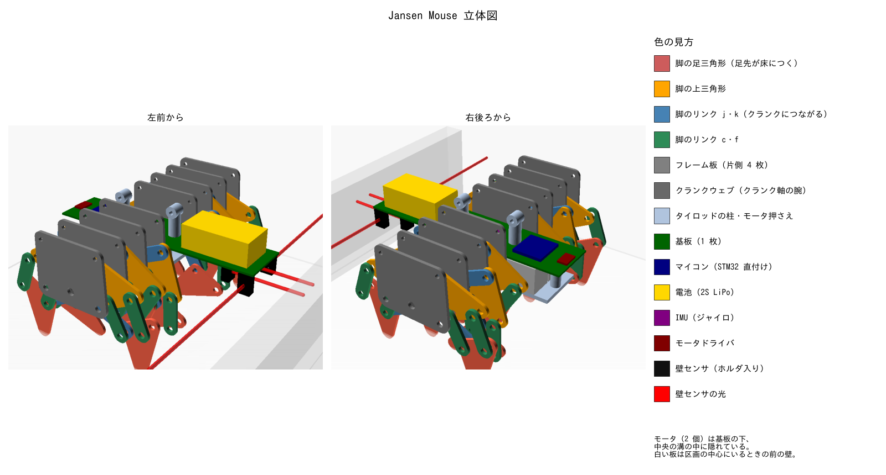

# Jansen Mouse — テオヤンセン機構で歩くクラシックマウス

タイヤの代わりに **テオヤンセン機構（Strandbeest の脚）** で歩く、マイクロマウス・クラシック競技（16×16 区画、1 区画 180 mm）用ロボットのプロジェクトです。



## 特徴

- **左右 2 モータ × 片側 6 脚（計 12 脚）**。片側 3 クランクスロー（120° 位相）× 前後鏡像ペア。
  常に片側 2 脚以上が接地する。
- 脚寸法は Theo Jansen の Holy Numbers を **0.40 mm/unit** に縮小、板は 1.5 mm 厚。
  クランク 1 回転で **54.4 mm** 前進（1 区画 ≈ 3.31 回転）。胴体の上下動は 0.03 mm。
- 機体は **111 × 114 mm**、超信地旋回の半径 72 mm。通路幅 168 mm の中で旋回できることを、
  部品の積層・干渉を自動計算して確認している。
- 脚は滑るので、**向きはジャイロで常に閉ループ**、距離はクランク回転数 × 1 回転あたりの前進量で管理。
- 迷路アルゴリズム（足立法）と制御則はハードウェア非依存にし、**PC 上で単体試験**（ランダム迷路 30 面で探索 → 帰還 → 最短経路を検証）。
- モータ・基板・電池・壁センサは**脚が掃引しない場所**（中央の溝・脚より上・脚より前）に配置し、
  干渉・センサの光路・旋回半径・重量（約 185 g）・転倒角を自動で検証している。
- 機構解析（Python）→ ファーム用定数ヘッダ（センサ位置を含む）/ CAD 寸法・積層順・組立図 を**自動生成**し、寸法の二重管理をなくしている。



部品ごとの説明つきの三面図は [docs/hardware.md](docs/hardware.md#機体構成) にあります。

## ディレクトリ構成

```
mechanism/   テオヤンセン機構の運動学シミュレーション (Python)
  jansen/      リンク計算・歩容解析・積層/干渉チェック・CLI
  tests/       pytest
firmware/    STM32F411 (Black Pill) 用ファームウェア (PlatformIO + Arduino)
  include/     config.h（調整値）, mechanism_params.h（自動生成）
  lib/maze/    迷路・歩数マップ・探索ロジック（ハード非依存）
  lib/control/ PID・台形速度プロファイル（ハード非依存）
  lib/mouse/   1kHz 走行制御・探索/最短走行の手順（ハード非依存）
  src/         ピン割り当て・ドライバ・メイン（実機専用）
  test/        Unity による PC 上の単体試験と走行シミュレーション
cad/         OpenSCAD のパラメトリック部品と組立図（*_generated.scad は自動生成）
docs/        設計資料・部品表・解析結果
```

## クイックスタート

### 機構シミュレーション

```bash
cd mechanism
pip install -r requirements.txt
python -m pytest -q
python -m jansen.cli report                 # 歩容指標とリンク長
python -m jansen.cli plot -o ../docs/images # 足先軌跡・接地数グラフ
python -m jansen.cli footprint              # 縮尺・スロー数ごとの機体外形
python -m jansen.cli body                   # 機体の部品配置の検証（干渉・センサの光路・重量）
```

寸法を変えたら、ファームと CAD の定数も再生成します。

```bash
python -m jansen.cli header   -o ../firmware/include/mechanism_params.h
python -m jansen.cli scad     -o ../cad/links_generated.scad
python -m jansen.cli assembly -o ../cad/assembly_generated.scad
python -m jansen.cli report   -o ../docs/jansen_report.md
```

（縮尺・スロー数を変える場合は `--scale` / `--throws` を付けるか、`jansen/cli.py` の既定値を変更）

### CAD

```bash
cd cad
openscad -D 'PART="layout"' -o leg_parts.stl parts.scad   # 脚 1 本分の部品
openscad -D 'PART="motor_clamp"' -o motor_clamp.stl parts.scad  # モータ押さえ
openscad -D 'PART="board_outline"' -o board.dxf parts.scad      # 基板（1 枚）の外形
openscad -o assembly.stl assembly_generated.scad          # 全体組立
```

### ファームウェア

```bash
cd firmware
pio test -e native          # PC 上で迷路・制御ロジックの試験
pio run -e blackpill_f411ce # 実機向けビルド
pio run -e blackpill_f411ce -t upload   # ST-LINK で書き込み
```

### 走行シミュレーション

実機と同じ走行制御・探索コード（`lib/mouse`）を、PC 上の模擬ロボットで動かします。
脚の滑り・1 回転内の速度の揺れ・ジャイロのずれ・赤外センサ（壁と柱へのレイキャスト）を模擬し、
ランダム迷路で「探索 → 帰還 → 最短走行」を行って、壁の誤検知と衝突がないことを確認します。

```bash
pio test -e native -f test_sim                      # 迷路 4 面（CI でも実行）
SIM_EXTENDED=1 pio test -e native -f test_sim -v    # さらに 12 面
SIM_TRACE=1 pio test -e native -f test_sim -v       # 壁の誤検知・衝突があった区画を表示
```

操作: **MODE** ボタンでモード選択 → **START** で実行。

| モード | 内容 |
|---|---|
| 0 | センサ確認（USB シリアルへ壁センサ・ジャイロ・エンコーダ・電池電圧を出力） |
| 1 | 探索走行（スタート → ゴール → スタート） |
| 2 | 最短走行（探索済みの壁のみで経路を作り、直線をまとめて走る） |
| 3 | 前進量の較正（5 区画直進し、実測との比を求める） |

## ドキュメント

- [設計資料](docs/design.md) — 機構寸法の決め方、レギュレーション適合、制御方針
- [ハードウェア](docs/hardware.md) — 部品表、ピン配置、組み立て・調整手順
- [機構解析レポート](docs/jansen_report.md) — 自動生成のリンク長表と歩容指標

## 開発状況

- [x] 機構の運動学シミュレーションと寸法決定
- [x] 迷路探索・最短経路アルゴリズム（PC 上で検証済み）
- [x] 実機ファームウェア（ビルド確認済み・実機未調整）
- [x] 走行シミュレーションで探索・最短走行を検証（16 面で衝突・壁の誤検知なし）
- [x] パラメトリック CAD（積層順の自動決定・干渉チェック・組立図）
- [x] 機体設計（部品配置・基板 1 枚・センサ配置の検証）
- [ ] 試作・実機でのパラメータ調整（センサ閾値、前進量の補正、PID ゲイン）
