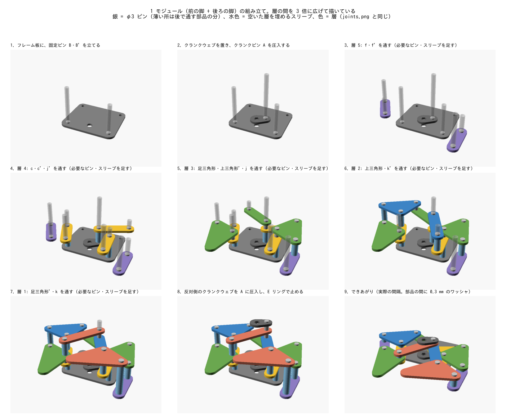
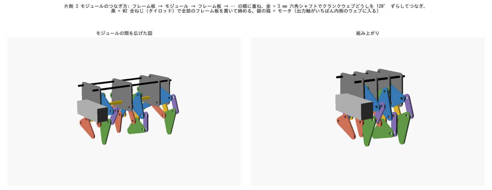

# 組み立て手順

部品の寸法と数は [parts_list.md](parts_list.md)、脚どうしのつなぎ方の図は [design.md](design.md#22-組立クランク軸と積層順)。
図は `python -m jansen.cli guide -o ../docs/images` で作り直せます（OpenSCAD と xvfb-run が必要）。

全体は「1 モジュール（前の脚 + 後ろの脚）を 6 個作る → 片側 3 個ずつつなぐ → 真ん中でモータと基板を付ける」の順です。

## 0. 準備

- 板の部品（リンク・三角形 72 個、クランクウェブ 12 枚、フレーム板 8 枚）
- φ3 ピンを長さごとに切っておく（6.3 / 8.1 / 9.9 / 11.7 / 13.5 mm）。クランクピンは 12.3 mm
- スリーブ（内径 3.2、長さ 1.8 / 3.6 / 5.4 mm）、0.3 mm のワッシャ、E リング

## 1. 1 モジュールを作る（× 6）

フレーム板を机に置き、その上に部品を下の層から順に重ねていきます（図は層の間を 3 倍に広げています）。

1. **フレーム板に固定ピン B・B' を立てる**。フレーム板の裏側を E リングで止める。後ろの脚の B' も同じ板から立てる。
2. **クランクウェブを置き、クランクピン A を圧入する**。ウェブの六角穴はフレーム板の軸受穴と同じ位置。
3. **層 5 → 層 1 の順に、部品をピンに通していく**。
   - 部品を置くたびに、その部品の穴の位置にまだピンがなければ、新しいピンを下から通す（関節 C〜F）。
   - 部品と部品の間には 0.3 mm のワッシャを 1 枚ずつ挟む。
   - 同じピンの途中で部品のない層は、スリーブで埋める（図の水色）。どの関節にどのスリーブが要るかは [parts_list.md](parts_list.md#3-ピンとスペーサ1-モジュールあたり)。
   - 前の脚と後ろの脚は、同じ部品を裏返して使う。図の色（層）のとおりに置けば、すれ違っても当たらない。
4. **反対側のクランクウェブを A に圧入する**。両方のウェブの向き（A の位置）が同じになるようにする。
5. **ピンの両端を E リングで止める**。ウェブを手で回して、引っかからずに 1 回転すること、足先が平らな所を通ることを確かめる。

## 2. 片側 3 モジュールをつなぐ（× 2）

1. いちばん内側のフレーム板（モータの側。固定ピンなし）を置く。
2. 1 個目のモジュールを、内側のウェブがこのフレーム板に向くように重ねる。**1 個目の内側のウェブはモータ軸用（D カット穴）**。
3. 2 個目のモジュールを重ね、1 個目の外側のウェブ → フレーム板の軸受穴 → 2 個目の内側のウェブ を **3 mm 六角シャフト**でつなぐ。
   六角穴で、2 個目のクランクピン A が 1 個目から **120°** 進んだ位置になるようにする。シャフトは短いのでウェブに接着する。
4. 3 個目も同じように、さらに 120° 進めてつなぐ（0° / 120° / 240°）。
5. **タイロッド（M2 全ねじ）**を 2 本、全部のフレーム板の上の穴に通す。フレーム板の間にはタイロッドのスリーブ（12.3 mm）を入れる。
   左右をつなぐので、ナットで締めるのは 3. で真ん中を組んだ後。

## 3. 真ん中（モータ・ブリッジ・基板）

1. 左右の組を、間にブリッジ（3D プリント）を挟んで向かい合わせ、タイロッドをブリッジのリブの穴にも通して、外側からナットで締める。
2. モータ 2 個を真ん中の溝に入れ、出力軸（D カット）を内側のフレーム板の軸受穴から、モータ軸用のウェブに差し込む。
3. モータ押さえを下から当て、M2 ネジ 2 本でブリッジの柱に留める。
4. 基板の裏に壁センサのホルダ 4 個を差し、基板をブリッジの上面に M2 ネジ 4 本で留める。電池を基板に載せる（位置は重心を真ん中にする位置、[jansen_report.md](jansen_report.md#機体の部品配置)）。
5. 左右のクランクの位相を合わせる: 左右とも 1 個目のクランクピン A が同じ向きになる所でモータ軸を差す
   （ファームは左右を別々に回すので、ずれていても歩けるが、揃えたほうが胴体の揺れが少ない）。
6. 足三角形の足先にゴムを貼る。

## 組み上がったら

[hardware.md の「組み立て・調整手順」](hardware.md#組み立て調整手順)で、エンコーダの向き・センサの値を確かめてから走らせます。
最初は片側だけ、手で回して引っかかりがないかを見て、それからモータで少しずつ速度を上げてください（[printing.md](printing.md#試作の順番)）。
