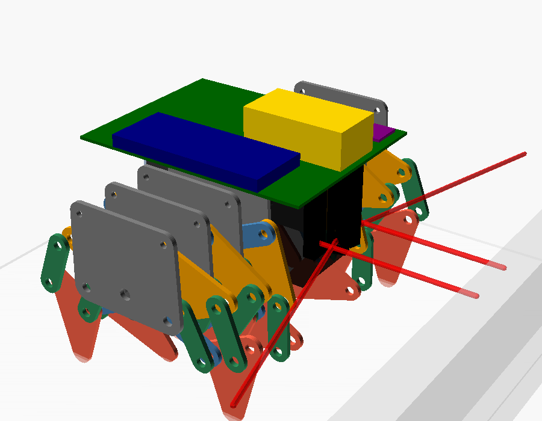
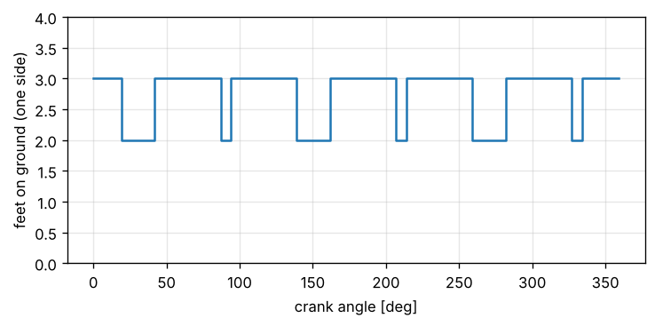

# 設計資料

## 1. コンセプト

マイクロマウスは通常タイヤ走行ですが、本機はテオヤンセン機構の脚で歩きます。
速さではなく「脚で迷路を解く」ことが目標です。そのため設計方針は次の 3 点です。

1. **区画中心で一旦停止する走行**（停止 → 壁検知 → 旋回 → 1 区画前進）。
   歩行の振動中に壁を読まなくて済み、確実性が高い。最短走行では直線区間をまとめて走る。
2. **向きはジャイロ、距離はクランク回転数**。脚は横滑りするため車輪型のオドメトリ（左右差から角度）は使わない。
3. **超信地旋回**（左右のクランクを逆回転）。テオヤンセン機構はクランクを逆転すると足先軌跡を逆にたどるので後退・旋回が可能。

## 2. 脚機構

### 2.1 リンク寸法

Theo Jansen の Holy Numbers を縮尺 `s` [mm/unit] で縮小して使います。

| 項目 | Holy Numbers 基準 (s = 1) | 本機 (s = 0.40) |
|---|---|---|
| クランク半径 m | 15 | 6.0 mm |
| 1 本の足の接地区間の長さ | 53.1 | 21.2 mm |
| **1 回転あたりの胴体の前進量**（片側 3 スロー） | 136.1 | **54.4 mm** |
| 足上げ高さ | 22.5 | 9.0 mm |
| クランク中心の対地高さ | 91.8 | 36.7 mm |
| 接地区間の平坦度 | 0.67 | 0.27 mm |

全リンク長は [jansen_report.md](jansen_report.md) を参照（自動生成）。

### 2.2 組立クランク軸と積層順

リンク j, k は回転中にクランク中心 O の真上を通過するため、**脚の層を貫く通し軸は置けません**。
そこで 1 スロー（前脚 + 鏡像の後脚）ごとに、2 枚のクランクウェブの間にクランクピン A だけを渡す
**組立クランク軸**にしています（自転車のクランクと同じ考え方）。

```
フレーム板 | ウェブ | 脚の層 1〜5 | ウェブ | フレーム板 | ウェブ | 脚の層 1〜5 | ウェブ | フレーム板 | ウェブ | 脚の層 1〜5 | ウェブ | フレーム板
           └──────── スロー 1 ────────┘            └──────── スロー 2（120°）────────┘            └──────── スロー 3（240°）────────┘
```

- モジュール間は 3 mm 六角シャフトでつなぎ、ウェブの六角穴で位相（60° 刻み、本機は 120° ずつ）を決める。
- 固定ピン B / B' はフレーム板から片持ちで立てる。
- 部品の層は `mechanism/jansen/assembly.py` が自動で決める。クランク 1 回転を 72 姿勢に分け、
  「同じ層の部品同士が 0.6 mm 以内に近づかない」「部品が自分の付いていないピンを横切らない」条件で
  層数最小の割り当てをバックトラック探索し、さらに独立した検査関数で再確認している。

| 層 | 部品（' は後脚） |
|---|---|
| 1 | T', k |
| 2 | U, k' |
| 3 | T, U', j |
| 4 | c, c', j' |
| 5 | f, f' |

（U = 上三角形 b-d-e、T = 足三角形 g-i-h）



### 2.3 縮尺・脚の本数・板厚の決め方

クラシックマウスの通路幅は 168 mm（区画 180 mm − 壁厚 12 mm）。区画中央で超信地旋回するには、
**機体中心から最も遠い点までの距離（旋回半径）が、壁までの 84 mm より小さい**必要があります。
位置ずれを見込み、余裕 10 mm 以上を条件にしました。旋回半径は、干渉チェック済みの積層から求めた
脚・フレームの実際の形で計算しています（外接長方形の対角で見積もると、厳しく出すぎる）。

（ワッシャ 0.3 mm、中央部 26 mm。`python -m jansen.cli footprint` で再生成できます）

| 脚の数 | 縮尺 | 板厚 | 全長 | 全幅 | 旋回半径 | 壁までの余裕 | 胴体の上下動 | 1 回転の前進量 |
|---|---|---|---|---|---|---|---|---|
| 8 | 0.35 | 2.0 | 82.0 | 102.4 | 64.0 | +20.0 | 0.51 | 44.1 |
| 8 | 0.35 | 1.5 | 82.0 | 85.4 | 58.1 | +25.9 | 0.51 | 44.1 |
| 8 | 0.40 | 2.0 | 92.7 | 102.4 | 67.6 | +16.4 | 0.58 | 50.5 |
| 8 | 0.40 | 1.5 | 92.7 | 85.4 | 62.0 | +22.0 | 0.58 | 50.5 |
| 8 | 0.45 | 2.0 | 103.4 | 102.4 | 71.4 | +12.6 | 0.65 | 57.0 |
| 8 | 0.45 | 1.5 | 103.4 | 85.4 | 66.1 | +17.9 | 0.65 | 57.0 |
| 12 | 0.35 | 2.0 | 82.0 | 138.6 | 78.8 | +5.2 | 0.03 | 47.4 |
| 12 | 0.35 | 1.5 | 82.0 | 113.6 | 68.8 | +15.2 | 0.03 | 47.4 |
| 12 | 0.40 | 2.0 | 92.7 | 138.6 | 81.7 | +2.3 | 0.03 | 54.5 |
| **12** | **0.40** | **1.5** | **92.7** | **113.6** | **72.2** | **+11.8** | **0.03** | **54.5** |
| 12 | 0.45 | 2.0 | 103.4 | 138.6 | 84.9 | -0.9 | 0.03 | 61.5 |
| 12 | 0.45 | 1.5 | 103.4 | 113.6 | 75.7 | +8.3 | 0.03 | 61.5 |
| 16 | 0.35 | 2.0 | 82.0 | 174.8 | 94.7 | -10.7 | 0.03 | 47.3 |
| 16 | 0.35 | 1.5 | 82.0 | 141.8 | 80.6 | +3.4 | 0.03 | 47.3 |
| 16 | 0.40 | 2.0 | 92.7 | 174.8 | 97.2 | -13.2 | 0.03 | 54.5 |
| 16 | 0.40 | 1.5 | 92.7 | 141.8 | 83.5 | +0.5 | 0.03 | 54.5 |
| 16 | 0.45 | 2.0 | 103.4 | 174.8 | 99.8 | -15.8 | 0.03 | 61.7 |
| 16 | 0.45 | 1.5 | 103.4 | 141.8 | 86.6 | -2.6 | 0.03 | 61.7 |

- **片側 3 スロー（12 脚）・縮尺 0.40・板厚 1.5 mm を採用**（前の構成は 8 脚・縮尺 0.45・板厚 2 mm）。旋回の余裕は 8 脚のとき（12.6 mm）とほぼ同じ 11.8 mm で、
  胴体の上下動が 0.65 → 0.03 mm と約 1/20 になる。
- 12 脚は板厚 2 mm だと幅が 139 mm になり、どの縮尺でも余裕が 5 mm 以下になる。板厚を 1.5 mm にして幅を 114 mm に収めた。
- 片側 4 スロー（16 脚）は、板厚 1.5 mm でも余裕が 3.4 mm 以下で不採用。
- 全長は膝関節 F の振り出し（クランク中心から 59 unit）で決まる。足先の範囲だけで見積もると過小評価になる。

> 経緯: 当初は「縮尺 0.55・片側 3 スロー」と見積もったが、膝関節の振り出しと積層厚を正しく計算すると収まらず、
> いったん 8 脚（縮尺 0.45・板厚 2 mm）にした。その後、旋回半径を実際の形で計算し直し、板厚を 1.5 mm にすれば 12 脚が収まることが分かった。

### 2.4 脚の本数と位相

`support_analysis` による比較（片側あたり）:

| クランクスロー数 | 脚数（片側） | 最小接地脚数 | 胴体の上下動 |
|---|---|---|---|
| 2（前の構成、s = 0.45） | 4 | 2 | 0.65 mm |
| **3（採用、s = 0.40）** | **6** | **2** | **0.03 mm** |

3 スロー（120° 位相）にすると胴体の上下動がほぼ消え、壁センサの値が安定し、前後の滑りも減ります
（前進量の 24 % → 17 %）。旋回中も各側 2 脚以上で支えます。



### 2.5 座標系と回転方向

`mechanism/jansen/linkage.py` では脚が −x 側に伸びる向きで計算しています。
クランクを反時計回り（+θ）に回すと接地中の足先は +x 方向へ動き、機体は −x 方向へ進みます。
実機では左右のモータ向きが鏡像になるため、前進でエンコーダが増える向きを `config.h` の `kMotorLSign / kMotorRSign` で合わせます。

## 3. レギュレーション適合（クラシック競技）

ニューテクノロジー振興財団の[クラシックマウス競技規定](https://www.ntf.or.jp/?page_id=118)（2022 年 6 月 1 日改定）と、
[全日本大会の運営に関する注意事項](https://www.ntf.or.jp/?page_id=124)（2024 年 12 月 7 日改定）による（2026 年 10 月に確認）。

| 項目 | 規定 | 本機 |
|---|---|---|
| 大きさ | 1-5 床面への投影が 1 辺 25 cm の正方形に収まる。高さの制限はない | 110 × 114 mm、高さ約 62 mm |
| 迷路 | 2-2 区画 18 cm × 18 cm、16 × 16 区画。壁の高さ 5 cm、厚さ 1.2 cm | この寸法で設計・シミュレーション |
| 格子点（柱） | 2-4 1.2 cm × 1.2 cm | 同上 |
| 色 | 2-1 壁の側面は白、上面は赤、床面は黒 | 壁センサは白い側面を見る（光の高さ 38.8 mm） |
| 壁を越えない・壊さない | 1-4 | 足は床面のみを移動。足先にゴムを貼る |
| 終点の通過 | 3-7 床面より 5 cm 以内の部分がすべて終点の区画に入ったとき | 5 cm 以内の部分は前後 110 mm に収まる |
| **持ち時間** | 規定 3-6 は 7 分・5 回。**全日本大会は 5 分・5 回**（運営に関する注意事項 第 5 条） | **探索に 4〜16 分かかる（下の「課題: 探索時間」）** |

> 出場する大会ごとに、最新の規定と運営の注意事項を確認してください。

### 壁センサの位置

壁の高さは 50 mm、クランク中心は地上 41 mm です。脚は機体中心から左右 13〜51 mm の範囲を床から高さ 60 mm 付近まで掃引するので、
壁センサは脚が占めない場所に置く必要があります（[hardware.md](hardware.md#脚が占めない場所に部品を置く)）。

- 4 本とも基板（1 枚）の前の端の裏に下げる（KOGUMA Mk4 と同じ考え方）。光の高さは地上 38.8 mm
- 前壁センサ（FL / FR）: 中央の溝の中、真正面向き
- 左右壁センサ（L / R）: 脚より前（x 60）、真横向き

## 4. 制御

```
1 kHz タイマ割り込み (Motion::tick)
 ├─ エンコーダ → クランク回転速度（ローパス）
 ├─ ジャイロ Z → ヨー角を積分
 ├─ 壁センサ（対角の 2 個ずつ FL・R / L・FR を交互に、点灯−消灯の差分）
 └─ モード別指令
     直進: 台形プロファイル v(t) + 向き保持(ジャイロ) + 左右壁で中央寄せ
     旋回: 台形プロファイル ω(t) + 角速度・角度のフィードバック
     前壁補正: FL+FR で距離、FL−FR で向きを合わせ、基準方位を更新
 → 左右クランク目標回転数 = (v ∓ ω·T/2) / 1 回転あたりの前進量
 → クランク速度 PID + フィードフォワード → PWM
```

- 歩行は 1 回転の中で速度が周期的に揺れるので、速度・センサ値には強めのローパス（α = 0.05）をかけています。
- 走行距離 = クランク回転数 × 1 回転あたりの前進量 × `kTravelCorrection`。滑りによる誤差はモード 3 で較正します。
- 前壁がある区画で旋回する前に前壁補正を行い、蓄積した距離・角度誤差をリセットします。
  前壁と直角になった時点でジャイロの向きの推定値を理想の向きに戻し、ドリフトも消します。
- 直進は速度プロファイルに**エンコーダ距離のフィードバック**を加え、目標距離に達するまで終わりません。
- 左右壁による中央寄せには積分動作（`wall_trim_`）を持たせ、ジャイロのドリフトで向きの基準がずれても壁に合わせて直します。
- **壁切れ**（横壁が途切れる瞬間）で走行距離を補正します。直進は必ず区画中心から始まるので、
  壁切れが起きる距離は「k × 180 mm + (90 + 6 − センサ前後位置) mm」に決まります。
- 両側に壁が続く通路では壁切れがないので、前壁がある場合は**前壁センサが区画中心の値に達した時点で止まります**。
- 旋回は目標角との差が 0.5° 未満・角速度 5 deg/s 未満になるまで続けます。
  足の横滑りで旋回の実効が落ちるため、旋回の角度ゲイン（`kTurnAngleKp`）は直進より強くしています。

## 5. 迷路アルゴリズム

- **探索**: 足立法。未知の壁は「無い」とみなした歩数マップで、最も歩数の小さい隣接区画へ進む。同点なら直進優先（脚機構は旋回が遅いため）。
  ゴール（中央 4 区画）到達後、同じ方法でスタートへ戻る。
- **最短走行**: 既知の壁のみ（未知は「有る」とみなす）で歩数マップを作り、連続する直進をまとめた動作列を生成。
- PC 上の試験（`firmware/test/test_maze`）で、ループを含むランダム迷路 30 面について
  「ゴール到達 → 帰還 → 既知壁のみの最短経路が真の迷路上で壁に衝突しない」ことを確認しています。

## 6. 駆動とモータ

`mechanism/jansen/drive.py` の解析結果です（`python -m jansen.cli report` で再生成できます）。

### 6.1 1 回転あたりの前進量

**1 回転で進む距離は「1 本の足の接地区間の長さ（21.2 mm）」ではありません。**
複数の脚が交代で胴体を支えるので、胴体は常に「接地中の足の速度」で進みます。
そのため 1 回転の前進量は ∫ v_接地足 dθ = **54.4 mm** になり、1 区画は 3.31 回転です（12 脚・縮尺 0.40）。

- 前進量の求め方は、速度を積分する方法と、接地足の位置を追う方法の 2 通りで計算し、10 % 以内で一致することをテストで確認しています。
- 1 回転の中で胴体の速度は ±10 % 揺れます（8 脚のときは ±27 %）。回転角から距離を直線で求めたときの誤差は最大 0.61 mm で、対応表を持つ必要はありません。
- 同時に接地している足の速度が食い違うため、前進量の 17 % 程度は足が床を擦って滑ります（8 脚のときは 24 %）。
  モデルは「胴体は接地足の平均速度で進む」としています。実機ではずれが出るので、モード 3 で補正します。

> 当初のファームは接地区間の長さ（当時の構成で 23.9 mm）を 1 回転の前進量に使っていたため、1 区画のつもりで約 2.4 区画進んでしまう状態でした（修正済み）。

### 6.2 必要なトルクと回転数

前提: 機体 200 g、足（ゴム）と床の摩擦係数 0.6、関節の摩擦をまとめた効率 0.6。

| 動作 | 片側クランクの最大トルク | 必要なクランク回転数 |
|---|---|---|
| 直進 | 2.6 N·mm | 99 rpm（90 mm/s） |
| 超信地旋回 | 6.6 N·mm | 121 rpm（180 deg/s） |

- 直進では、トルクのほとんどが足の前後の滑りに使われます（12 脚では胴体の上下動がほぼないため、8 脚より軽い）。
- 旋回では、脚が足を横に動かせないため、接地足がクランク軸からの前後距離 |x| に比例して横に滑ります。これが直進の約 2.5 倍の負荷になります。
- 12 脚にして左右の脚群の間隔が広がった（64 → 70 mm）ので、同じ旋回速度に必要なクランク回転数が増えました。
- **モータ（減速後）の要求は 145 rpm 以上で 0.20 kgf·cm 以上**です（回転数 +20 %、トルク安全率 3）。
  N20 ウォームギヤモータであれば、減速後 150〜200 rpm の品で十分な余裕があります。
- 摩擦係数・関節効率は仮定値です。試作後に電流値（トルク）を測って見直してください。

## 7. 走行シミュレーション

`firmware/test/test_sim` で、実機と同じ走行制御・探索コード（`lib/mouse`）を模擬ロボット上で 1 kHz で動かします。

| 模擬するもの | モデル |
|---|---|
| モータ | duty → クランク角速度の 1 次遅れ（30 ms） |
| 歩行 | 胴体速度 = クランク角速度 × 胴体速度表（`mechanism_params.h`、1 回転内の ±27 % の揺れ）× 前進量の誤差 |
| 旋回 | 左右の速度差から。足の横滑りで実効 75 % |
| 外乱 | 歩行中のランダムなヨー、ジャイロのバイアス 0.2 deg/s とノイズ |
| 壁センサ | 機体設計どおりの位置から、壁・柱（12 mm 角）へのレイキャストで距離 d を求め、4000 × (r0 / d)² の ADC 値 + ノイズ（r0 = 30）。対角の 2 個ずつ交互に更新 |
| 衝突 | 機体外形（脚の掃引範囲、`mechanism_params.h` の全長 × 全幅）が壁・柱に入ったら記録 |

### 見つかって直したファームの不具合

| 不具合 | 症状 | 修正 |
|---|---|---|
| 前壁補正の回転方向が逆 | 傾きを補正するつもりで逆に回し、その向きを基準にしてしまう | 符号を修正。補正後はジャイロ推定値を理想の向きに戻す |
| 直進の距離が時間で決まっていた | 速度追従の遅れがそのまま距離誤差になる | エンコーダ距離のフィードバックと完了判定を追加 |
| ジャイロのドリフトに中央寄せが負ける | 1 区画あたり約 3 mm 横にずれていく | 中央寄せに積分動作を追加 |
| 旋回が目標角に届かない | 足の滑りで 1 回あたり約 3° 不足（時間切れで終了） | 旋回専用の角度ゲインと、収束を待つ完了判定 |
| 前進量の誤差が蓄積 | 両側に壁が続く通路で 1 区画 5 mm ずつ行き過ぎ、前壁に衝突 | 壁切れによる距離補正と、前壁での停止 |
| 最短走行で前壁補正をしない | 誤差が蓄積して衝突 | 旋回前に前壁補正 |

### 結果

前進量の誤差 0 / ±3 % を含むランダム迷路 16 面で、探索（スタート → ゴール → スタート）と最短走行を行い、
**衝突 0 回・壁の誤検知 0 件**、スタートへの戻り位置のずれ 1〜14 mm でした。

左右センサの向きによる比較（迷路 4 面）:

| 向き | 結果 |
|---|---|
| 60°（斜め前） | 壁のない区画で隣の柱を壁と誤検知し、探索が行き詰まる |
| 75° | 探索は成功するが、最短走行で衝突 |
| **90°（真横）** | **全て成功** |

### 課題: 探索時間

区画ごとに止まって壁を見る方式（探索速度 60 mm/s）のため、走行シミュレーションでは探索（往復）に
**約 250〜1000 秒（4〜16 分）**かかります（迷路 16 面）。**全日本大会の持ち時間は 5 分**なので、
多くの迷路で探索の途中で時間切れになります。

短縮する方法:
- 直進中は止まらずに次の区画の壁を読む、探索速度を上げる、帰り道を最短経路が確定した時点で切り上げる
  （PR #4 で試作。迷路 16 面の合計で 27 % 短縮）
- 旋回（前壁補正 + 超信地旋回で 1 回 1.5 秒前後）を減らす走り方
- 探索をゴールまでにして、帰りは探索しない

## 8. 機体設計

部品の配置は `mechanism/jansen/body.py` にまとめ、次を自動で検証しています（`python -m jansen.cli body`、`pytest`）。

| 検証 | 結果 |
|---|---|
| 部品と脚の掃引域・フレーム板の干渉 | なし |
| 壁センサの光（半角 10° の円すい、区画中心にいるとき壁面まで）を遮るもの | なし |
| 超信地旋回の半径 | 72.2 mm（壁まで 84 mm） |
| 重量 | 約 185 g（駆動トルクの見積もりの前提 200 g 以内） |
| 横方向の転倒角 | 39°（最も内側の脚だけが接地する瞬間で評価） |

検証で分かったこと:

- **以前の壁センサの配置は脚の掃引域の中で、物理的に成り立たなかった**（4 つとも光路が脚に遮られる）。
  KOGUMA Mk4 を参考に、4 本を 1 枚の基板の前の端の裏に下げた（[hardware.md](hardware.md#壁センサkoguma-mk4-を参考にした)）。
- センサの配置を変えるたびに走行シミュレーションで見つかったファームの不具合:
  - 壁に近いセンサは値の変化が大きく、中央寄せが発振した → センサ値を距離（mm）に換算してから制御に使う（値はほぼ距離の 2 乗に反比例）
  - 柱（12 mm 角）を一瞬だけ壁として見て、中央寄せが反応した → 25 mm 以上続けて見えた壁だけを使う
  - 壁の終わりで値が下がると、距離に換算した横ずれが大きくなり急に曲がった → 横ずれを ±10 mm に制限し、区画中央の値の 30 % 未満は使わない
  - 前壁補正が時間で打ち切られて傾きが約 25 % 残り、それをジャイロの基準にしていた → 傾き・距離が収まるまで続ける
  - 前に出した左右センサは、行き過ぎると次の区画の壁を見る → 前進の途中で、左右センサが次の区画の中心を通る瞬間に横壁を読む
- これらの修正後、走行シミュレーション 16 面（前進量の誤差 ±3 % を含む）を衝突・誤検知なしで完了。

基板は 1 枚にしました。迷路の壁は高さ 50 mm（競技規定）なので、壁センサの光はそれより下に出す必要があり、
脚の上（高さ 64 mm 以上）には置けません。そこで基板を、脚が入らない中央の溝の中、モータのすぐ上（高さ 44 mm）に置き、
KOGUMA Mk4 と同じく壁センサを基板の裏に下げています（光の高さ 38.8 mm）。

経緯: 最初は脚の上にメイン基板、脚の前に別の壁センサ基板を置き、溝を埋める中央シャーシ（約 19 g）で支えていた。
シャーシを必要な所だけのブリッジ（約 7 g）にしたあと、基板を 1 枚にしてブリッジもなくした
（モータは基板とモータ押さえで挟み、基板はタイロッドの柱で留める）。機体は 211 → 199 → 185 g、高さは 81 → 77 → 62 mm、
重心は 43 → 42 → 38 mm になった。

モータの外形（12 x 14 x 41 mm）と重量は代表的な値の仮定です。購入したら `body.py` の値を実測値に直して再検証してください。
