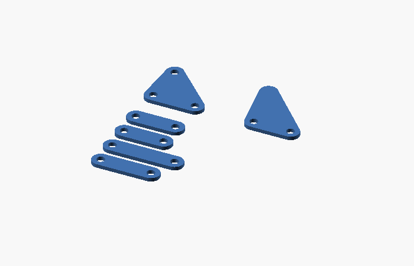

# ハードウェア

## 部品表（1 台分の目安）

| 区分 | 部品 | 数量 | 備考 |
|---|---|---|---|
| マイコン | WeAct Black Pill (STM32F411CEU6) | 1 | 100 MHz, USB CDC でログ出力 |
| モータ | N20 ウォームギヤモータ（出力軸が直交するタイプ）磁気エンコーダ付き。**減速後 130〜200 rpm、定格トルク 0.25 kgf·cm 以上** | 2 | 要求値の根拠は [design.md](design.md#6-駆動とモータ)。7 PPR → 4 逓倍で 28 count/rev。モータ本体を前後方向に寝かせて中央部の幅を 26 mm に収める。購入後に `kGearRatio`・`kMaxCrankRps` を合わせる |
| モータドライバ | DRV8835 | 1 | MODE=High（PHASE/ENABLE） |
| ジャイロ | ICM-20602 または MPU-6500（SPI） | 1 | ±2000 dps で使用 |
| 壁センサ | 赤外 LED（SFH4550 等）+ フォトトランジスタ（ST-1KL3A 等） | 各 4 | LED は MOSFET（2N7002 等）で前方・側方を別系統駆動。配置は下の「壁センサの配置」 |
| 電源 | 2S LiPo 7.4 V 200〜300 mAh | 1 | 3.3 V は Black Pill のレギュレータ、または別途 LDO |
| UI | タクトスイッチ 2、圧電ブザー 1 | | |
| 脚 | 2 mm 厚 板（POM / アクリル のレーザー加工、または PLA 3D プリント） | 8 脚分 | `cad/parts.scad` |
| クランク軸 | クランクウェブ 8 枚、φ3 クランクピン 4 本、3 mm 六角シャフト | | ウェブは `web()`。六角穴で位相を合わせる |
| フレーム | フレーム板 6 枚、M2 スペーサ | | `frame()`。片側 3 枚（内側・中間・外側） |
| 継手 | モータ軸（φ3 D カット）→ 六角シャフト | 2 | `coupler()` |
| ピン | φ3 mm シャフト or M3 ネジ + ナイロンナット、0.3 mm ワッシャ | 約 70 | リンク関節 |
| 足先 | ゴムシート / 熱収縮チューブ | 8 | 滑り止め |

> 重量目標: 200 g 以下。

## ピン配置

| 機能 | ピン | 備考 |
|---|---|---|
| 左モータ PWM / DIR | PA8 / PB12 | TIM1_CH1 |
| 右モータ PWM / DIR | PA9 / PB13 | TIM1_CH2 |
| 左エンコーダ A / B | PB4 / PB5 | 外部割り込み |
| 右エンコーダ A / B | PB6 / PB7 | 外部割り込み |
| IR LED 前方 / 側方 | PB14 / PB15 | MOSFET ゲート |
| 受光 FL / L / R / FR | PA0 / PA1 / PA2 / PA3 | ADC |
| IMU SPI (CS/SCK/MISO/MOSI) | PA4 / PA5 / PA6 / PA7 | SPI1 |
| 電池電圧 | PB1 | 20k / 10k 分圧 |
| ブザー | PA15 | |
| MODE / START ボタン | PA10 / PB3 | 内部プルアップ |
| 状態 LED | PC13 | オンボード |

タイマ: TIM1 = モータ PWM (20 kHz)、TIM10 = `tone()`、**TIM11 = 1 kHz 制御ループ**。

## 機体構成

```
              前
   ┌──────────────────────────────┐
   │ 左脚群  │ 電装部  │ 右脚群  │   全長 103 mm × 全幅 102 mm
   │ 4 脚    │ 26 mm   │ 4 脚    │   左右それぞれ: 2 スロー（180° 位相）
   │ 38 mm   │         │ 38 mm   │   各スローに前向き脚 + 後ろ向き脚（鏡像）
   └──────────────────────────────┘
              後
```


- 各側: フレーム板 | ウェブ | 脚 5 層 | ウェブ | フレーム板 | ウェブ | 脚 5 層 | ウェブ | フレーム板。
  積層順は [design.md](design.md#22-組立クランク軸と積層順) の表のとおり（自動計算・干渉チェック済み）。
- 組立図は `cad/assembly_generated.scad`（`python -m jansen.cli assembly --theta 角度` で任意のクランク角を生成）。
- フレーム板どうしはクランク中心から 25 mm 上の M2 スペーサでつなぐ（脚の可動域より上なので干渉しない）。
- 電装部は左右の脚群の間。壁センサ基板は電装部の前端に付け、地上 25〜35 mm に配置。

### 壁センサの配置

走行シミュレーション（`firmware/test/test_sim`）で検証した配置です。

| センサ | 位置（クランク軸から） | 向き |
|---|---|---|
| FL / FR | 前 45 mm、左右 ±20 mm | 真正面 |
| L / R | 前 35 mm（`cfg::kSideSensorForwardMm`）、左右 ±15 mm | **真横（90°）** |

- 左右センサを斜め前（60°・75°）に向けると、壁のない区画で隣の柱を壁と誤検知したり、最短走行で衝突したりした。
  真横なら柱から十分離れたところで壁を見るので誤検知しない。
- 左右センサの前後位置は壁切れ（横壁が途切れる位置）による距離補正に使うので、実機の値を
  `kSideSensorForwardMm` に正確に入れる。

## 組み立て・調整手順

1. `cad/parts.scad` で部品を出力（`PART` を切り替え）。脚 1 本あたり: バー j, k, c, f 各 1、上三角形 1、足三角形 1。
   後脚は同じ部品を裏返して使う。

   
2. 関節はガタが少なく、かつ軽く回ることを優先。組み立て後、手でクランクを回して全姿勢で引っ掛かりがないか確認。
3. モード 0 で以下を確認・設定する。
   - 前進方向にクランクを手で回して、左右のエンコーダが**増える**こと（逆なら `config.h` の `kMotorLSign / kMotorRSign`）。
   - 機体を左に回すとヨー角が**増える**こと。
   - 壁センサの値は `src/main.cpp` の `g_tuning`（`mouse::WallTuning`）に入れる:
     - 左右と前に壁がある区画の中央に置いたときの L / R → `side_ref_l / side_ref_r`
     - そのときの FL + FR → `front_ref_sum`
     - 壁あり / なしの中間値 → `thr_front / thr_side`
4. モード 3 で前進量の較正: 5 区画（900 mm）を歩かせ、実際の移動距離を測る。
   `kTravelCorrection *= 実測 / 900` とする。
5. 1 区画直進・90° 旋回を繰り返して PID を調整してから、モード 1 で探索。
