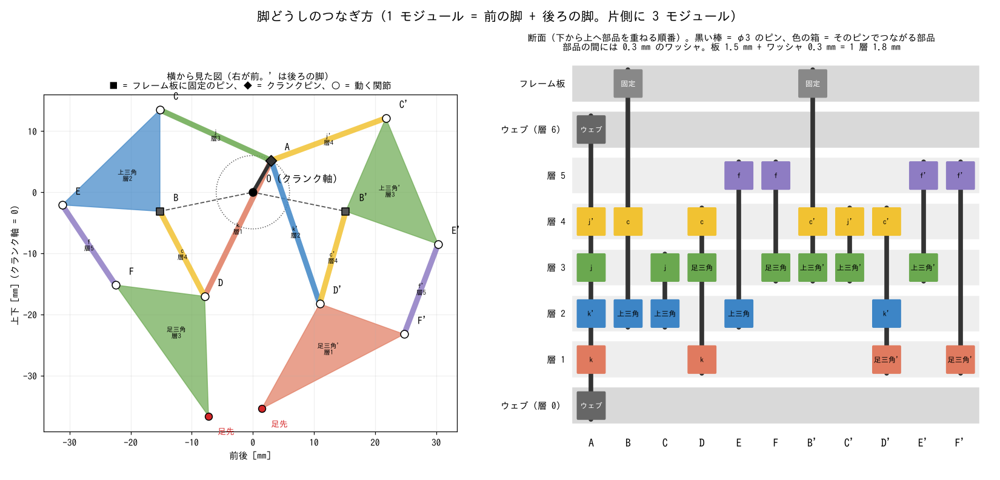

# 部品ごとの表

自動生成: `python -m jansen.cli parts -o ../docs/parts_list.md`（寸法・積層順を変えたら作り直す）。
脚 12 本 = 片側 3 モジュール × 左右。1 モジュール = 前の脚 + 後ろの脚（前後に裏返した同じ部品）。
板厚 1.5 mm、部品の間のワッシャ 0.3 mm（1 層 1.8 mm）、リンク幅 7.0 mm、ピン穴 φ3.2。
積層順は [design.md](design.md#22-組立クランク軸と積層順)、3D プリントは [printing.md](printing.md)。

## 1. 板の部品（脚・クランク・フレーム）

| 部品 | ファイル（`cad/print/`） | 外形 [mm] | 穴 | 層 | 1 モジュール | 1 台 |
|---|---|---|---|---|---|---|
| リンク j | `bar_j.stl` | 27.0 × 7.0 | φ3.2 × 2（中心間 20.00） | 3（後ろ 4） | 2 | 12 |
| リンク k | `bar_k.stl` | 31.8 × 7.0 | φ3.2 × 2（中心間 24.76） | 1（後ろ 2） | 2 | 12 |
| リンク c | `bar_c.stl` | 22.7 × 7.0 | φ3.2 × 2（中心間 15.72） | 4（後ろ 4） | 2 | 12 |
| リンク f | `bar_f.stl` | 22.8 × 7.0 | φ3.2 × 2（中心間 15.76） | 5（後ろ 5） | 2 | 12 |
| 上三角形（B・C・E） | `tri_upper.stl` | 23.6 × 23.0 | φ3.2 × 3（辺 16.60 / 16.04 / 22.32） | 2（後ろ 3） | 2 | 12 |
| 足三角形（D・F・足先） | `tri_foot.stl` | 24.8 × 26.4 | φ3.2 × 2（辺 14.68 / 19.60 / 26.28）。足先にゴム | 3（後ろ 1） | 2 | 12 |
| クランクウェブ | `web.stl` | 14.0 × 9.0 | 六角穴（3 mm 六角シャフト）+ クランクピン圧入穴 φ2.9（中心間 6.00） | 0 と 6 | 2 | 10 |
| クランクウェブ（モータ軸用） | `web_motor.stl` | 同上 | D カット穴（モータ軸 φ3）+ φ2.9 | 0（いちばん内側） | — | 2 |
| フレーム板 | `frame.stl` | 約 39.4 × 32.1 | 軸受 φ3.8、固定ピン φ3.2 × 2、タイロッド φ2.2 × 2 | モジュールの間 | — | 8 |

板の部品の合計: リンク・三角形 72 個、クランクウェブ 12 枚、フレーム板 8 枚。

## 2. 3D プリントの部品（機体）

| 部品 | ファイル | 外形 [mm] | 数 | 備考 |
|---|---|---|---|---|
| ブリッジ | `print_bridge.stl` | 59.2 × 25.0 × 20.0 | 1 | 左右の内側フレーム板をつなぎ、モータを上から押さえ、上面に基板を留める。天板を下にして刷る |
| モータ押さえ | `print_motor_clamp.stl` | 55.0 × 25.0 × 16.5 | 1 | モータを下から支え、柱をブリッジのボスにネジ止め |
| 壁センサのホルダ | `print_sensor_holder.stl` | 6.0 × 4.04 × 26.7 | 4 | 黒（光を通さない）。本番は光造形を推奨 |

## 3. ピンとスペーサ（1 モジュールあたり）

ピンは φ3 の丸棒（ステンレス / 鋼）。長さ = つなぐ部品の範囲 + E リングを付ける端ごとに 1.5 mm（溝の分）。端の外側の層を別の部品が通る所は、E リングもピンの出っ張りも当たるので、**ピンを端の部品に接着（または圧入）して面一**にし、もう一方の端の E リングで抜け止めにする（クランク 1 回転を 72 姿勢に分けて、E リングの外径 6.4 mm で確認）。途中で空いている層は、内径 3.2・外径 4 mm 以下のスリーブで埋める（脚の層は外径 4 mm のピンで干渉を確認している）。

| 関節 | つなぐ部品（層） | ピンの長さ | 端（層の小さい側 / 大きい側） | スリーブ | ワッシャ | 備考 |
|---|---|---|---|---|---|---|
| A | ウェブ（0）、リンク k（1）、リンク k'（2）、リンク j（3）、リンク j'（4）、ウェブ（6） | 12.3 mm | 面一・接着 / 面一・接着 | 1.8 mm | 5 | クランクピン。両端をクランクウェブに圧入 |
| B | 上三角形（2）、リンク c（4）、フレーム板（7） | 12.0 mm | 面一・接着 / E リング | 1.8 mm、3.6 mm | 2 | フレーム板から片持ちで立てる固定ピン |
| B' | 上三角形'（3）、リンク c'（4）、フレーム板（7） | 10.2 mm | 面一・接着 / E リング | 3.6 mm | 2 | フレーム板から片持ちで立てる固定ピン |
| C | 上三角形（2）、リンク j（3） | 6.3 mm | E リング / E リング | — | 1 |  |
| C' | 上三角形'（3）、リンク j'（4） | 6.3 mm | E リング / E リング | — | 1 |  |
| D | リンク k（1）、足三角形（3）、リンク c（4） | 8.4 mm | E リング / 面一・接着 | 1.8 mm | 2 |  |
| D' | 足三角形'（1）、リンク k'（2）、リンク c'（4） | 8.4 mm | E リング / 面一・接着 | 1.8 mm | 2 |  |
| E | 上三角形（2）、リンク f（5） | 8.4 mm | 面一・接着 / E リング | 3.6 mm | 1 |  |
| E' | 上三角形'（3）、リンク f'（5） | 6.6 mm | 面一・接着 / E リング | 1.8 mm | 1 |  |
| F | 足三角形（3）、リンク f（5） | 8.1 mm | E リング / E リング | 1.8 mm | 1 |  |
| F' | 足三角形'（1）、リンク f'（5） | 11.7 mm | E リング / E リング | 5.4 mm | 1 |  |

1 台分（× 6 モジュール）:

| もの | 長さ | 数 |
|---|---|---|
| φ3 ピン | 6.3 mm | 12 |
| φ3 ピン | 6.6 mm | 6 |
| φ3 ピン | 8.1 mm | 6 |
| φ3 ピン | 8.4 mm | 18 |
| φ3 ピン | 10.2 mm | 6 |
| φ3 ピン | 11.7 mm | 6 |
| φ3 ピン | 12.0 mm | 6 |
| φ3 クランクピン | 12.3 mm | 6 |
| スリーブ（内径 3.2） | 1.8 mm | 36 |
| スリーブ（内径 3.2） | 3.6 mm | 18 |
| スリーブ（内径 3.2） | 5.4 mm | 6 |
| ワッシャ（φ3 用、厚さ 0.3 mm） | — | 114 |
| E リング（φ3 軸用） | — | 84 |

## 4. 軸・タイロッド・ネジ（1 台）

| もの | 寸法 | 数 | 備考 |
|---|---|---|---|
| 3 mm 六角シャフト | 長さ 5.1 mm | 4 | モジュールの間のつなぎ（ウェブ + フレーム板 + ウェブ）。六角穴で 120° ずつ位相を合わせる。短いのでウェブの六角穴に接着する |
| ワッシャ（M4 用 = 内径 4.3 前後、厚さ 0.3 mm） | — | 12 | クランク軸 O の、フレーム板とウェブの間（1 モジュールの両側に 1 枚ずつ）。六角シャフト（対角 3.46 mm）・モータ軸に通す |
| M2 全ねじ（タイロッド） | 約 123 mm | 2 | 左右すべてのフレーム板とブリッジを貫く |
| M2 ナット | — | 4 | タイロッドの両端 |
| タイロッドのスリーブ（内径 2.2） | 12.9 mm | 12 | フレーム板の間（1 モジュールの厚さ − フレーム板）|
| M2 ネジ（基板 → ブリッジ） | 長さ 5 mm 前後 | 4 | ブリッジの下穴 φ1.8 にねじ込む |
| M2 ネジ（モータ押さえ → ブリッジ） | 長さ 約 22 mm | 2 | モータ押さえの柱を下から通す |
| 足のゴム | ゴムシート / 熱収縮チューブ | 12 | 足三角形の足先 |

電装部品（マイコン・モータ・センサ・電池など）は [hardware.md](hardware.md#部品表1-台分の目安) の部品表を参照。

## 5. 買う部品を減らした試作キット（1 組 = 前の脚 + 後ろの脚）

3D プリントの部品・1.75 mm のフィラメント・瞬間接着剤だけで 1 組を組めるようにした版（`cad/print_kit_generated.scad`）。
ワッシャとスリーブは穴のまわりの「ボス」として部品と一緒に刷り、ピンはフィラメントを切って使う。
クランク軸は外側のウェブに六角軸を一緒に刷り、タイロッドの代わりに内側のフレーム板に柱を刷る。
ボスはどの部品も片面だけなので、ボスを上にして平らに刷れる。組むときはボスをフレーム板（外側）の側に向ける。

| ファイル（`cad/print/`） | 部品 | 1 組 | ボス（穴のまわりの出っ張り） |
|---|---|---|---|
| `kit_j_front.stl` | リンク j（前の脚） | 1 | 0.2 mm |
| `kit_j_back.stl` | リンク j（後ろの脚） | 1 | 2.0 mm |
| `kit_k_front.stl` | リンク k（前の脚） | 1 | 0.2 mm、2.0 mm |
| `kit_k_back.stl` | リンク k（後ろの脚） | 1 | 0.2 mm、2.0 mm |
| `kit_c_front.stl` | リンク c（前の脚） | 1 | 3.8 mm |
| `kit_c_back.stl` | リンク c（後ろの脚） | 1 | 3.8 mm |
| `kit_f_front.stl` | リンク f（前の脚） | 1 | — |
| `kit_f_back.stl` | リンク f（後ろの脚） | 1 | — |
| `kit_U_front.stl` | 上三角形（前の脚） | 1 | 2.0 mm、0.2 mm、3.8 mm |
| `kit_U_back.stl` | 上三角形（後ろの脚） | 1 | 0.2 mm、0.2 mm、2.0 mm |
| `kit_T_front.stl` | 足三角形（前の脚） | 1 | 0.2 mm、2.0 mm |
| `kit_T_back.stl` | 足三角形（後ろの脚） | 1 | 0.2 mm、5.6 mm |
| `kit_web_inner.stl` | クランクウェブ（内側。六角穴） | 1 | 0.2 mm |
| `kit_web_outer.stl` | クランクウェブ（外側。六角軸つき） | 1 | —（六角軸 3.6 mm） |
| `kit_frame_outer.stl` | フレーム板（外側。固定ピン B・B' を立てる） | 1 | — |
| `kit_frame_inner.stl` | フレーム板（内側。柱つき） | 1 | —（柱 12.9 mm × 2） |
| `kit_hex_axle.stl` | 六角軸 + つまみ（試作で手で回す） | 1 | —（六角軸 3.3 mm） |

| 関節 | フィラメントの長さ | 端（層の小さい側 / 大きい側） |
|---|---|---|
| A | 12.3 mm | 接着 / 接着 |
| B | 11.5 mm | 接着（面一） / 頭 |
| B' | 9.7 mm | 接着（面一） / 頭 |
| C | 5.3 mm | 頭 / 頭 |
| C' | 5.3 mm | 頭 / 頭 |
| D | 7.9 mm | 頭 / 接着（面一） |
| D' | 7.9 mm | 頭 / 接着（面一） |
| E | 8.9 mm | 頭 / 頭 |
| E' | 7.1 mm | 頭 / 頭 |
| F | 7.1 mm | 頭 / 頭 |
| F' | 10.7 mm | 頭 / 頭 |

フィラメントの合計: 約 94 mm（1 組）。

- 「頭」: フィラメントを部品から 1 mm 出しておき、はんだごて（または熱した金属）で押しつぶして抜け止めにする。
- 「接着（面一）」: その端のすぐ外側の層を別の部品が通るので、出っ張らせない。端の部品の面に揃えて瞬間接着剤で留める。
- 「接着」（クランクピン A）: 両方のウェブに接着する（ウェブ 2 枚とピンが 1 つのクランクになる）。
- 本番（金属ピン）より弱く、穴もすり減るので、手で回して動きを確かめるための試作用。
